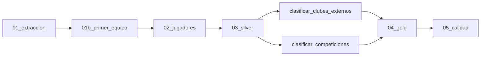

# Transfermarkt Scraper + Data Pipeline | Argentine Youth Academy Ranking (careers from 1985)

Pipeline de datos en Databricks que descarga datos de [Transfermarkt](https://www.transfermarkt.com) para determinar **qué clubes argentinos forman mejores juveniles**. Parte de los clubes de Primera y de Primera Nacional, llega hasta cada jugador que empezó su carrera en ellos y deja tablas por tema listas para cruzar con SQL.

> Este repositorio contiene solo código y documentación. No incluye datos descargados y no está afiliado a Transfermarkt.

**Resultados:** ver la sección [Resultados](#resultados): aporte de cada club según métrica y segmento, ingresos por formación y casos de jugadores.

## Qué permite responder

| Pregunta | Tabla |
| --- | --- |
| ¿Qué clubes formaron más jugadores? | `gold_ranking_formados` |
| ¿Cuántos jugadores salen de las inferiores de cada club y adónde van? | `gold_salidas`, `gold_ranking_salidos` |
| ¿Cómo cambia el ranking por camada (año de debut)? | `gold_ranking_camada` |
| ¿Cuánto aporta cada club a una métrica elegida (goles, partidos, asistencias), por posición y lustro de debut? | `gold_aporte` |
| ¿Cuánto le correspondería a cada club formador por solidaridad en los traspasos con `fee`? | `gold_ingresos` |

No hay un puntaje único de éxito: la capa gold tiene una tabla por tema y se cruzan con SQL según la pregunta.

## Alcance

- **Ligas:** Primera y Primera Nacional (códigos de Transfermarkt `ARG1`, `AR1N` y `ARG2`).
- **Equipos:** primer equipo y juveniles (II, U20, U19, etc.).
- **Temporadas:** desde 1985. Un jugador entra solo si su carrera empieza desde ahí: primer registro desde la temporada 85/86 y debut en un club que no es juvenil desde 1985.
- **Datos por jugador:** perfil, estadísticas, valor de mercado, carrera en selecciones, logros y traspasos.

## Arquitectura

Capas bronze → silver → gold sobre tablas Delta en `workspace.inferiores`. El Job `pipeline_inferiores` corre en Databricks serverless con estas tareas y dependencias:



Las tareas `silver` y `gold` tienen la condición de ejecución *If all done*, y cada una consulta el estado del ciclo antes de hacer nada.

## Notebooks

Cada notebook tiene una celda de texto antes de cada celda de código que explica qué hace, sus parámetros y sus tablas.

| Notebook | Qué hace | Tablas principales |
| --- | --- | --- |
| `00_codigos` | Descubre los códigos de liga de cada temporada a partir de cuatro clubes. No forma parte del Job: documenta de dónde salen los códigos que se usan después | `ligas_spielplan_semilla`, `ligas_codigos_por_anio` |
| `ciclo` | Funciones del estado del ciclo semanal. Los demás notebooks lo cargan con `%run ./ciclo`; no es una tarea del Job | `bronze_ciclos` |
| `01_extraccion` | Clubes de cada liga y temporada, equipos juveniles de cada club y movimientos (entradas y salidas) de cada equipo en cada temporada | `bronze_clubs`, `bronze_youth_teams_v2`, `bronze_arrivals`, `bronze_departures` |
| `01b_primer_equipo` | Amplía el universo con jugadores que empezaron su carrera en uno de los clubes sin pasar por una página juvenil (carreras viejas) | `bronze_pe_arrivals`, `bronze_candidatos`, `bronze_universo_extra` |
| `02_jugadores` | Baja las 6 llamadas de la API para cada jugador: `transfers`, `stats`, `profile`, `market_value`, `national_career` y `achievements` | `bronze_player_raw`, `bronze_corridas` |
| `03_silver` | Convierte el JSON de la API en 8 tablas silver, una por tema | `silver_players`, `silver_transfers`, `silver_player_stats`, etc. |
| `clasificar_clubes_externos` | Clasifica los clubes que no se conocen (padre, juvenil, marcador) recorriendo las carreras de los jugadores y visitando sus páginas | `bronze_clubes_externos` |
| `clasificar_competiciones` | Busca en Transfermarkt la categoría de cada competición (liga y nivel, copa, juvenil, etc.) | `bronze_competiciones` |
| `04_gold` | Construye las 18 tablas gold | `gold_*` |
| `05_calidad` | Valida la capa gold: unicidad de claves, fechas plausibles y pesos de aporte entre 0 y 1. Solo lee tablas y termina con error si algún chequeo falla. Corre solo si el ciclo se publicó en las últimas 12 horas | no escribe tablas |

## Ciclo semanal y reanudación

- Cada ciclo corresponde a una semana y se identifica por su lunes en hora de Argentina. Se abre uno nuevo solo cuando el anterior ya se publicó y empezó una semana nueva.
- Cada notebook decide si le toca correr según el estado del ciclo (`bronze_ciclos`): la extracción corre hasta terminar; `02_jugadores` corre hasta tener todas las llamadas de todos los jugadores; silver, las dos clasificaciones y gold corren solo cuando los jugadores están completos y el ciclo no se publicó. Al terminar, `04_gold` marca el ciclo como publicado. `05_calidad` valida las tablas gold sin modificar el ciclo, solo en las horas siguientes a la publicación.
- En cada ciclo se refrescan los jugadores activos; los retirados quedan congelados.
- Las corridas se pueden cortar y retomar: lo pendiente se calcula siempre desde las tablas, y las páginas ya descargadas salen de un caché en un Volume de Databricks.
- Si Transfermarkt frena (HTTP 202, 403 o 429), la corrida se corta. Los notebooks que bajan jugadores dejan además una pausa registrada en `bronze_corridas`, y `02_jugadores` tiene un tope de horas por día.
- El widget `FORZAR` de `ciclo` permite correr un notebook a mano ignorando el estado del ciclo.

## Cómo se escriben silver y gold

- **Reescritura completa.** Cada tabla silver y gold se escribe entera en cada publicación, con `overwrite` (y `overwriteSchema`) o con `CREATE OR REPLACE TABLE`. No hay escrituras incrementales ni `MERGE`.
- **Silver** (`03_silver`) parte de `bronze_player_raw`: para cada jugador toma la respuesta más reciente (`fecha` más nueva) de cada llamada con estado `hecho` y la descompone en las 8 tablas, una por tema.
- **Gold** (`04_gold`) lee silver y las tablas de clasificación (`bronze_clubes_externos` y `bronze_competiciones`) y construye las 18 tablas en el orden del notebook, porque las celdas dependen unas de otras.
- **Idempotencia.** Como cada tabla se recalcula completa desde bronze, volver a correr un notebook da el mismo resultado, y el control de ciclo evita reconstruir cuando no hay nada nuevo para publicar.
- **Controles.** Después de cada escritura, `03_silver` y `04_gold` ejecutan consultas de control con `display` (conteos, claves únicas, comparaciones contra silver y muestras al azar) para inspección manual. No cortan el Job: eso lo hace `05_calidad`.

## Métrica de formación

`gold_formacion_fifa` reparte la formación de cada jugador entre los clubes por los que pasó, como el mecanismo de solidaridad de la FIFA sobre un pozo de 100 %: los años calendario de los 12 a los 15 años valen 5 % cada uno y los de los 16 a los 23 años, 10 % cada uno. `gold_formacion_debut` corta ese reparto en el año del debut en un club que no es juvenil y lo normaliza para que cada jugador sume 1. Los rankings usan esas dos tablas, con y sin los años rellenados hacia atrás hasta el primer club que figura.

## Capa gold

| Tema | Tablas |
| --- | --- |
| Clubes y trayectorias | `gold_club_familia`, `gold_linea_tiempo` |
| Debut | `gold_debut` |
| Formación | `gold_formacion_fifa`, `gold_formacion_debut` |
| Rankings | `gold_ranking_formados`, `gold_salidas`, `gold_ranking_salidos`, `gold_ranking_camada` |
| Jugadores | `gold_jugador`, `gold_seleccion`, `gold_valor_mercado_serie`, `gold_valor_mercado`, `gold_minutos`, `gold_logros` |
| Competiciones | `gold_competicion` |
| Aporte e ingresos | `gold_aporte`, `gold_ingresos` |

## Resultados

Todas las cifras salen de consultas SQL sobre la capa gold (`workspace.inferiores`), ejecutadas en Databricks. Las consultas están al final de esta sección.

**Cómo leer los resultados**

- **Peso de formación:** la parte de cada jugador que se lleva cada club formador. En los criterios `debut` y `fifa` suma 1 por jugador.
- **Aporte:** peso × métrica del jugador, sumado por club formador (`gold_aporte`). Cada club recibe crédito proporcional a su parte en la formación.
- **Criterio:** todas las segmentaciones usan *debut con relleno*. Se puede cambiar por cualquiera de los otros tres (`debut_sin_relleno`, `fifa`, `fifa_sin_relleno`) cambiando la columna.
- **Relleno:** asigna los años anteriores al primer club que figura en la fuente a ese primer club. Sin relleno solo cuenta lo que está registrado.
- **Lustro:** lustro de debut del jugador. "2000-2009" significa jugadores que debutaron entre 2000 y 2009.
- Solo se muestran clubes del universo analizado (`en_los_105`).

### 1. Aporte por club: la misma pregunta con distintos segmentos

No hay un ranking único: el resultado depende de qué métrica y qué segmento se elijan. Estas cuatro consultas muestran cómo cambia el panorama al segmentar.

#### Asistencias de mediocampistas (debutaron 2000-2009)

| club | aporte |
|---|---|
| CA River Plate | 1316.8 |
| CA Boca Juniors | 939.0 |
| CA Rosario Central | 662.2 |
| CA Vélez Sarsfield | 563.5 |
| CA Lanús | 560.2 |
| Club Estudiantes de La Plata | 508.3 |
| CA Newell's Old Boys | 435.3 |
| Club de Gimnasia y Esgrima La Plata | 379.5 |
| CA San Lorenzo de Almagro | 291.3 |
| Racing Club | 286.7 |

| jugador | club | aporte |
|---|---|---|
| Rubens Sambueza | CA River Plate | 160.0 |
| Maxi Moralez | Racing Club | 156.0 |
| Matías Delgado | CA River Plate | 133.1 |
| Nico Gaitán | CA Boca Juniors | 133.0 |
| Damián Díaz | CA Rosario Central | 131.0 |

#### Partidos en las 7 grandes ligas de Europa (debutaron desde 2000)

| club | aporte |
|---|---|
| CA River Plate | 5569.0 |
| CA Boca Juniors | 5131.4 |
| CA Vélez Sarsfield | 2379.1 |
| Club Estudiantes de La Plata | 2292.1 |
| CA Rosario Central | 2264.3 |
| Racing Club | 2179.0 |
| CA San Lorenzo de Almagro | 1749.3 |
| CA Banfield | 1424.1 |
| CA Newell's Old Boys | 1418.7 |
| CA Independiente | 1281.1 |

| jugador | club | aporte |
|---|---|---|
| Ángel Di María | CA Rosario Central | 503.0 |
| Sergio Agüero | CA Independiente | 454.0 |
| Gonzalo Higuaín | CA River Plate | 428.0 |
| Nicolás Otamendi | CA Vélez Sarsfield | 426.0 |
| Papu Gómez | Arsenal FC (*) | 383.0 |

(*) Arsenal de Sarandí.

#### Partidos en selección mayor (debutaron desde 1985)

| club | aporte |
|---|---|
| CA River Plate | 1123.2 |
| CA Newell's Old Boys | 677.4 |
| CA Boca Juniors | 597.1 |
| AA Argentinos Juniors | 493.1 |
| CA Rosario Central | 487.6 |
| CA Vélez Sarsfield | 432.3 |
| Club Estudiantes de La Plata | 371.3 |
| Racing Club | 363.9 |
| CA Independiente | 269.5 |
| Club Ferro Carril Oeste | 260.6 |

| jugador | club | aporte |
|---|---|---|
| Javier Mascherano | CA River Plate | 147.0 |
| Ángel Di María | CA Rosario Central | 145.0 |
| Nicolás Otamendi | CA Vélez Sarsfield | 140.0 |
| Roberto Ayala | Club Ferro Carril Oeste | 106.7 |
| Javier Zanetti | CA Talleres (Remedios de Escalada) | 103.9 |

#### Goles de delanteros (debutaron 1985-1999)

| club | aporte |
|---|---|
| CA Newell's Old Boys | 1370.6 |
| CA River Plate | 1218.8 |
| Club Estudiantes de La Plata | 947.8 |
| CA Boca Juniors | 896.4 |
| CA Rosario Central | 727.0 |
| CA Independiente | 716.2 |
| Racing Club | 470.5 |
| CA Vélez Sarsfield | 461.8 |
| Club Atlético Platense | 358.5 |
| CA San Lorenzo de Almagro | 341.6 |

| jugador | club | aporte |
|---|---|---|
| Martín Palermo | Club Estudiantes de La Plata | 260.0 |
| Diego Milito | Racing Club | 253.0 |
| Hernán Crespo | CA River Plate | 248.0 |
| David Trezeguet | Club Atlético Platense | 245.5 |
| Gabriel Batistuta | CA Newell's Old Boys | 245.0 |

### 2. Ingresos por club formador

Montos en millones de euros, nominales (sin ajuste por inflación).

- **Venta propia (`venta_propia`):** lo que el club cobra por vender al jugador, neto de la parte de solidaridad.
- **Solidaridad (`solidaridad`):** lo que le corresponde a cada club formador del 5 % de solidaridad de la FIFA, según su peso (`peso_solidaridad`) en la formación del jugador. Solo se computa en traspasos con `fee`.

| club | venta_propia_M | solidaridad_M | total_M |
|---|---|---|---|
| CA River Plate | 653.4 | 73.8 | 727.2 |
| CA Boca Juniors | 488.3 | 37.1 | 525.4 |
| CA Vélez Sarsfield | 305.4 | 24.9 | 330.3 |
| Racing Club | 254.1 | 18.0 | 272.1 |
| Club Estudiantes de La Plata | 191.0 | 23.7 | 214.7 |
| CA Independiente | 188.9 | 13.1 | 202.0 |
| CA Lanús | 187.4 | 11.5 | 198.9 |
| AA Argentinos Juniors | 158.4 | 17.3 | 175.6 |
| CA San Lorenzo de Almagro | 163.0 | 10.8 | 173.8 |
| CA Newell's Old Boys | 133.5 | 22.6 | 156.1 |

Jugadores que más ingresos generaron:

| jugador | venta_propia_M | solidaridad_M | total_M |
|---|---|---|---|
| Enzo Fernández | 42.6 | 11.7 | 54.3 |
| Franco Mastantuono | 44.0 | 1.0 | 45.0 |
| Javier Saviola | 34.7 | 1.3 | 36.1 |
| Mateo Retegui | 22.5 | 5.5 | 28.0 |
| Carlos Tévez | 24.5 | 3.0 | 27.4 |
| Esequiel Barco | 25.3 | 0.6 | 25.9 |
| Lautaro Martínez | 24.1 | 0.5 | 24.6 |
| Walter Samuel | 21.9 | 2.7 | 24.5 |
| Rodrigo Bentancur | 22.7 | 1.4 | 24.1 |
| Sergio Agüero | 22.5 | 1.4 | 23.9 |

**Limitaciones de esta tabla**

- No se puede ajustar por inflación: el fútbol tuvo una inflación muy fuerte en los precios de traspaso, así que los clubes con buena formación reciente le comen terreno a los que tuvieron mejores inferiores en el pasado.
- Hay un sesgo por posición: los delanteros se venden por más que los defensores, y los mediocampistas por más que los arqueros.

### 3. Cómo cambia el peso según el criterio: jugadores de ejemplo

Cada tabla muestra cómo se reparte la formación de un jugador entre sus clubes con los cuatro criterios. La fila `TOTAL` muestra que las columnas *sin relleno* no suman 1: representan solo la parte de la formación respaldada por datos registrados.

#### Enzo Fernández (id 648195)

Todo el peso en River con debut y relleno; sin relleno cae a 0.10.

| club | debut | debut_s_rell | fifa | fifa_s_rell |
|---|---|---|---|---|
| CA River Plate | 1.00 | 0.10 | 0.67 | 0.22 |
| Chelsea FC | 0.00 | 0.00 | 0.19 | 0.19 |
| Defensa y Justicia | 0.00 | 0.00 | 0.09 | 0.09 |
| SL Benfica | 0.00 | 0.00 | 0.06 | 0.06 |
| TOTAL | 1.00 | 0.10 | 1.00 | 0.55 |

#### Gabriel Batistuta (id 5959)

Todo el peso en Newell's con debut y relleno; sin relleno queda en 0.00.

| club | debut | debut_s_rell | fifa | fifa_s_rell |
|---|---|---|---|---|
| CA Newell's Old Boys | 1.00 | 0.00 | 0.60 | 0.00 |
| ACF Fiorentina | 0.00 | 0.00 | 0.14 | 0.14 |
| CA River Plate | 0.00 | 0.00 | 0.12 | 0.12 |
| CA Boca Juniors | 0.00 | 0.00 | 0.09 | 0.09 |
| Club Sportivo Italiano | 0.00 | 0.00 | 0.05 | 0.05 |
| TOTAL | 1.00 | 0.00 | 1.00 | 0.40 |

#### Carlos Tévez (id 4276)

Con el criterio FIFA, el peso se reparte entre los clubes de toda su carrera hasta los 23 años; con debut, casi todo queda en Boca.

| club | debut | debut_s_rell | fifa | fifa_s_rell |
|---|---|---|---|---|
| CA Boca Juniors | 0.94 | 0.94 | 0.68 | 0.68 |
| CA All Boys | 0.06 | 0.00 | 0.02 | 0.00 |
| Sport Club Corinthians Paulista | 0.00 | 0.00 | 0.17 | 0.17 |
| West Ham United | 0.00 | 0.00 | 0.09 | 0.09 |
| Manchester United | 0.00 | 0.00 | 0.04 | 0.04 |
| TOTAL | 1.00 | 0.94 | 1.00 | 0.98 |

#### Lionel Messi (id 28003)

Parte del peso va a un club fuera del universo (Barcelona). Por eso su aporte a Newell's es una fracción de sus métricas.

| club | debut | debut_s_rell | fifa | fifa_s_rell |
|---|---|---|---|---|
| FC Barcelona | 0.81 | 0.81 | 0.93 | 0.93 |
| CA Newell's Old Boys | 0.19 | 0.00 | 0.07 | 0.00 |
| TOTAL | 1.00 | 0.81 | 1.00 | 0.93 |

#### Facundo Colidio (id 491705)

El relleno sostiene gran parte del peso de Boca; sin relleno queda en 0.00.

| club | debut | debut_s_rell | fifa | fifa_s_rell |
|---|---|---|---|---|
| CA Boca Juniors | 0.62 | 0.00 | 0.37 | 0.00 |
| Inter Milan | 0.32 | 0.32 | 0.25 | 0.25 |
| Sint-Truidense VV | 0.06 | 0.06 | 0.19 | 0.19 |
| Club Atlético Tigre | 0.00 | 0.00 | 0.15 | 0.15 |
| CA River Plate | 0.00 | 0.00 | 0.04 | 0.04 |
| TOTAL | 1.00 | 0.38 | 1.00 | 0.63 |

### 4. Limitaciones de los datos de origen

Los resultados dependen de lo que Transfermarkt tiene registrado. Estos dos casos muestran dónde la fuente no alcanza y el modelo queda mal.

#### Marcelo Delgado (id 39086)

Debutó en Rosario Central, pero la fuente no tiene datos de partidos de Central de esa época. Como consecuencia, el primer partido registrado en un club no juvenil es el de Cruz Azul, y el debut con relleno le asigna peso (0.06) a un club donde no se formó.

| club | debut | debut_s_rell | fifa | fifa_s_rell |
|---|---|---|---|---|
| CA Rosario Central | 0.94 | 0.56 | 0.75 | 0.45 |
| CD Cruz Azul | 0.06 | 0.06 | 0.10 | 0.10 |
| Racing Club | 0.00 | 0.00 | 0.15 | 0.15 |
| TOTAL | 1.00 | 0.63 | 1.00 | 0.70 |

#### Ezequiel Lavezzi (id 50570)

La página no tiene datos suficientes de su etapa formativa, y la distribución de la formación queda distorsionada respecto de la realidad.

| club | debut | debut_s_rell | fifa | fifa_s_rell |
|---|---|---|---|---|
| CA Estudiantes | 0.50 | 0.50 | 0.30 | 0.30 |
| CA Boca Juniors | 0.50 | 0.00 | 0.25 | 0.00 |
| CA San Lorenzo de Almagro | 0.00 | 0.00 | 0.29 | 0.29 |
| SSC Napoli | 0.00 | 0.00 | 0.15 | 0.15 |
| Genoa CFC | 0.00 | 0.00 | 0.01 | 0.01 |
| TOTAL | 1.00 | 0.50 | 1.00 | 0.75 |

Son errores de la fuente, no del pipeline: el modelo reparte lo que está registrado. La capa bronze conserva el dato crudo para poder auditar cada caso.

### Consultas utilizadas

<details>
<summary>Aporte por club y top de jugadores (plantilla)</summary>

Cada segmento cambia la columna de métrica y los filtros:

| Segmento | Métrica (columna) | Filtros |
|---|---|---|
| Asistencias de mediocampistas | `asistencias_no_juv` | `position_group = 'Midfielder'`, `lustro_desde` entre 2000 y 2005 |
| Partidos en las 7 grandes ligas | `partidos_7_grandes` | `lustro_desde >= 2000` |
| Partidos en selección mayor | `partidos_mayor` | `lustro_desde >= 1985` |
| Goles de delanteros | `goles_no_juv` | `position_group = 'Striker'`, `lustro_desde` entre 1985 y 1995 |

```sql
-- Top 10 clubes (ejemplo: partidos en las 7 grandes ligas)
SELECT a.club_familia_name AS club,
       ROUND(SUM(a.debut * a.partidos_7_grandes), 1) AS aporte
FROM workspace.inferiores.gold_aporte a
WHERE a.en_los_105 AND a.lustro_desde >= 2000
GROUP BY a.club_familia_name
ORDER BY aporte DESC
LIMIT 10;

-- Top 5 jugadores
SELECT j.name AS jugador, a.club_familia_name AS club,
       ROUND(a.debut * a.partidos_7_grandes, 1) AS aporte
FROM workspace.inferiores.gold_aporte a
JOIN workspace.inferiores.gold_jugador j ON a.player_id = j.player_id
WHERE a.en_los_105 AND a.lustro_desde >= 2000
ORDER BY aporte DESC
LIMIT 5;
```

</details>

<details>
<summary>Ingresos por club formador y por jugador</summary>

```sql
SELECT club_familia_name AS club,
       ROUND(SUM(CASE WHEN tipo = 'venta_propia' THEN monto END)/1e6, 1) AS venta_propia_M,
       ROUND(SUM(CASE WHEN tipo = 'solidaridad'  THEN monto END)/1e6, 1) AS solidaridad_M,
       ROUND(SUM(monto)/1e6, 1) AS total_M
FROM workspace.inferiores.gold_ingresos
WHERE en_los_105
GROUP BY club_familia_name
ORDER BY total_M DESC
LIMIT 10;

SELECT j.name AS jugador,
       ROUND(SUM(CASE WHEN i.tipo = 'venta_propia' THEN i.monto END)/1e6, 1) AS venta_propia_M,
       ROUND(SUM(CASE WHEN i.tipo = 'solidaridad'  THEN i.monto END)/1e6, 1) AS solidaridad_M,
       ROUND(SUM(i.monto)/1e6, 1) AS total_M
FROM workspace.inferiores.gold_ingresos i
JOIN workspace.inferiores.gold_jugador j ON i.player_id = j.player_id
WHERE i.en_los_105
GROUP BY j.name
ORDER BY total_M DESC
LIMIT 10;
```

</details>

<details>
<summary>Pesos de un jugador de ejemplo</summary>

```sql
SELECT COALESCE(club_familia_name, 'TOTAL') AS club,
       ROUND(SUM(debut), 2)             AS debut,
       ROUND(SUM(debut_sin_relleno), 2) AS debut_s_rell,
       ROUND(SUM(fifa), 2)              AS fifa,
       ROUND(SUM(fifa_sin_relleno), 2)  AS fifa_s_rell
FROM workspace.inferiores.gold_aporte
WHERE player_id = '648195'
GROUP BY ROLLUP(club_familia_name)
ORDER BY GROUPING(club_familia_name), debut DESC, fifa DESC;
```

</details>

## Volumen de datos y ejecución

Cifras al 22/11/2026.

**Universo:** 105 clubes formadores y 13,828 jugadores. Jugadores con peso de formación asignado, por lustro de debut (total 13,528):

| lustro de debut | jugadores |
|---|---|
| 1985-1989 | 100 |
| 1990-1994 | 259 |
| 1995-1999 | 698 |
| 2000-2004 | 820 |
| 2005-2009 | 1,295 |
| 2010-2014 | 2,227 |
| 2015-2019 | 1,783 |
| 2020-2024 | 3,073 |
| 2025-2029 | 557 |
| Sin debut | 2,716 |

> Nota: los 13,528 jugadores con peso de formación incluyen 3 que no figuran en `gold_jugador` (ver [Limitaciones](#limitaciones)), por eso el total no es 13,828 − 303 sino 13,828 − 303 + 3.

**Tablas:** 17 bronze, 8 silver y 18 gold, más 2 tablas auxiliares con los códigos de liga por temporada. Las más grandes de cada capa:

| capa | tabla | filas |
|---|---|---|
| bronze | `bronze_player_raw` | 342,627 |
| bronze | `bronze_pe_arrivals` | 46,783 |
| bronze | `bronze_departures` | 19,618 |
| silver | `silver_player_stats` | 227,721 |
| silver | `silver_transfers` | 97,579 |
| silver | `silver_market_value_history` | 71,022 |
| gold | `gold_formacion_fifa` | 163,929 |
| gold | `gold_minutos` | 152,190 |
| gold | `gold_formacion_debut` | 128,603 |
| gold | `gold_linea_tiempo` | 110,672 |
| gold | `gold_aporte` | 32,135 |
| gold | `gold_ingresos` | 8,832 |

**Traspasos con fee:** 8,832 filas en `gold_ingresos` (2,620 de venta propia y 6,212 de solidaridad), entre 1987 y septiembre de 2026.

**Ejecución:** el Job corre todos los días a las 20:00 (hora de Argentina), con un tope de horas por día. Un ciclo semanal completo (extracción, clasificaciones, silver y gold) tarda entre 2 y 3 días corridos desde el inicio hasta la publicación. Hasta ahora se publicaron 4 ciclos.


*Historial del Job `pipeline_inferiores`: una corrida diaria a las 20:00 (hora de Argentina). Las corridas largas son las de descarga de jugadores; cuando el ciclo ya está completo, cada notebook consulta su estado y la corrida termina en un par de minutos.*

## Limitaciones

- **Fuente única.** Todo parte de Transfermarkt. Los huecos y errores de la fuente se arrastran a las métricas (ver los casos de Delgado y Lavezzi en los resultados): el pipeline reparte lo que está registrado y no lo corrige.
- **Ingresos parciales.** Solo se computan los traspasos con `fee`; las cesiones y los pases libres no suman. Los montos son nominales, sin ajuste por inflación, y favorecen a las posiciones ofensivas.
- **Scraping y API no oficial.** La extracción depende de las páginas de Transfermarkt y de una API no oficial (`transfermarkt-api`). Si Transfermarkt frena los pedidos (HTTP 202, 403 o 429), la corrida se corta; por eso el ciclo semanal es reanudable y usa un caché de páginas.
- **Alcance acotado.** Solo entran jugadores cuya carrera empieza desde 1985 y que se formaron en los clubes del universo (Primera y Primera Nacional). Quienes se formaron en otros clubes no aparecen.
- **Jugadores sin peso de formación.** 303 jugadores (2.2 % del universo) no tienen peso de formación y por eso no aparecen en `gold_aporte`. A 217 de ellos la fuente no les registra fecha de nacimiento, así que no se pueden asignar sus años de formación (de los 12 a los 23) a ningún club.
- **Tres jugadores sin perfil.** Para 3 jugadores (ids 28712, 100508 y 19925) la llamada `profile` de la API devuelve siempre un error 502 (`Unexpected upstream payload for PlayerProfile`), mientras que el resto de sus llamadas (`transfers`, `stats`, `market_value`, `national_career`, `achievements`) se descarga bien. Sin perfil no se genera su fila en `silver_players`, así que no aparecen en `gold_jugador`, pero sí tienen peso de formación y figuran en `gold_formacion_fifa` y `gold_aporte`. De ahí que las tablas de peso tengan 3 jugadores más que `gold_jugador`. El ciclo se completa igual sin sus perfiles y el impacto es de 3 jugadores sobre 13,528. Es un error de la API, no del pipeline.

## Fuentes y acceso

- **Páginas de Transfermarkt** (clubes, equipos, traspasos, competiciones): se bajan con `curl`. Antes de cada pedido no cacheado, el código consulta el `robots.txt` de `www.transfermarkt.com` y espera entre 3 y 5 segundos.
- **Datos por jugador:** se obtienen con [felipeall/transfermarkt-api](https://github.com/felipeall/transfermarkt-api), fijada en un commit y levantada localmente dentro del compute de Databricks.

## Puesta en marcha

Requisitos en Databricks:

1. El esquema `workspace.inferiores` y el Volume `workspace.inferiores.scraper`, donde se guarda el caché de páginas.
2. Los `.ipynb` importados en la misma carpeta del workspace: los demás notebooks cargan `ciclo` con `%run ./ciclo`.
3. El Job `pipeline_inferiores`, definido como código en `databricks.yml` (Databricks Asset Bundle). Se despliega desde el workspace (Git folder → Deployments → Deploy) o con `databricks bundle deploy`.

## Stack

Databricks (serverless), Delta Lake, Python, PySpark y Spark SQL, `curl` y Databricks Asset Bundles.

## Decisiones de diseño

**Reescritura completa en silver y gold.** Con este volumen (la tabla más grande de silver tiene unas 230.000 filas) reconstruir todo es más simple de razonar y de depurar que mantener cargas incrementales; si el volumen creciera, el paso natural sería pasar a `MERGE`.

**Notebooks como tareas del Job.** Se eligieron notebooks como tareas del Job por simplicidad de despliegue en Databricks; `ciclo` es la única dependencia compartida y se carga con `%run`.
