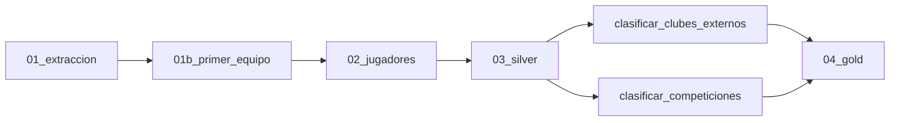

# Transfermarkt Scraper + Data Pipeline | Argentine Youth Academy Ranking (careers from 1985)

Pipeline de datos en Databricks que descarga datos de [Transfermarkt](https://www.transfermarkt.com) para determinar **qué clubes argentinos forman mejores juveniles**. Parte de los clubes de Primera y de Primera Nacional, llega hasta cada jugador que empezó su carrera en ellos y deja tablas por tema listas para cruzar en Power BI.

> Este repositorio contiene solo código y documentación. No incluye datos descargados y no está afiliado a Transfermarkt.

## Qué permite responder

| Pregunta | Tabla |
|---|---|
| ¿Qué clubes formaron más jugadores? | `gold_ranking_formados` |
| ¿Cuántos jugadores salen de las inferiores de cada club y adónde van? | `gold_salidas`, `gold_ranking_salidos` |
| ¿Cómo cambia el ranking por camada (año de debut)? | `gold_ranking_camada` |
| ¿Cuánto le correspondería a cada club formador por solidaridad en los traspasos con `fee`? | `gold_ingresos` |

No hay un puntaje único de éxito: la capa gold tiene una tabla por tema y se cruzan en Power BI.

## Alcance

- **Ligas:** Primera y Primera Nacional (códigos de Transfermarkt `ARG1`, `AR1N` y `ARG2`).
- **Equipos:** primer equipo y juveniles (II, U20, U19, etc.).
- **Temporadas:** desde 1985. Un jugador entra solo si su carrera empieza desde ahí: primer registro desde la temporada 85/86 y debut en un club que no es juvenil desde 1985.
- **Datos por jugador:** perfil, estadísticas, valor de mercado, carrera en selecciones, logros y traspasos.

## Arquitectura

Capas bronze → silver → gold sobre tablas Delta en `workspace.inferiores`. El Job `pipeline_inferiores` corre en Databricks serverless con estas tareas y dependencias:

Las tareas `silver` y `gold` tienen la condición de ejecución *If all done*, y cada una consulta el estado del ciclo antes de hacer nada.

## Notebooks

Cada notebook tiene una celda de texto antes de cada celda de código que explica qué hace, sus parámetros y sus tablas.

| Notebook | Qué hace | Tablas principales |
|---|---|---|
| `00_codigos` | Descubre los códigos de liga de cada temporada a partir de cuatro clubes. No forma parte del Job: documenta de dónde salen los códigos que se usan después | `ligas_spielplan_semilla`, `ligas_codigos_por_anio` |
| `ciclo` | Funciones del estado del ciclo semanal. Los demás notebooks lo cargan con `%run ./ciclo`; no es una tarea del Job | `bronze_ciclos` |
| `01_extraccion` | Clubes de cada liga y temporada, equipos juveniles de cada club y movimientos (entradas y salidas) de cada equipo en cada temporada | `bronze_clubs`, `bronze_youth_teams_v2`, `bronze_arrivals`, `bronze_departures` |
| `01b_primer_equipo` | Amplía el universo con jugadores que empezaron su carrera en uno de los clubes sin pasar por una página juvenil (carreras viejas) | `bronze_pe_arrivals`, `bronze_candidatos`, `bronze_universo_extra` |
| `02_jugadores` | Baja las 6 llamadas de la API para cada jugador: `transfers`, `stats`, `profile`, `market_value`, `national_career` y `achievements` | `bronze_player_raw`, `bronze_corridas` |
| `03_silver` | Convierte el JSON de la API en 8 tablas silver, una por tema | `silver_players`, `silver_transfers`, `silver_player_stats`, etc. |
| `clasificar_clubes_externos` | Clasifica los clubes que no se conocen (padre, juvenil, marcador) recorriendo las carreras de los jugadores y visitando sus páginas | `bronze_clubes_externos` |
| `clasificar_competiciones` | Busca en Transfermarkt la categoría de cada competición (liga y nivel, copa, juvenil, etc.) | `bronze_competiciones` |
| `04_gold` | Construye las 18 tablas gold | `gold_*` |

## Ciclo semanal y reanudación

- Cada ciclo corresponde a una semana y se identifica por su lunes en hora de Argentina. Se abre uno nuevo solo cuando el anterior ya se publicó y empezó una semana nueva.
- Cada notebook decide si le toca correr según el estado del ciclo (`bronze_ciclos`): la extracción corre hasta terminar; `02_jugadores` corre hasta tener todas las llamadas de todos los jugadores; silver, las dos clasificaciones y gold corren solo cuando los jugadores están completos y el ciclo no se publicó. Al terminar, `04_gold` marca el ciclo como publicado.
- En cada ciclo se refrescan los jugadores activos; los retirados quedan congelados.
- Las corridas se pueden cortar y retomar: lo pendiente se calcula siempre desde las tablas, y las páginas ya descargadas salen de un caché en un Volume de Databricks.
- Si Transfermarkt frena (HTTP 202, 403 o 429), la corrida se corta. Los notebooks que bajan jugadores dejan además una pausa registrada en `bronze_corridas`, y `02_jugadores` tiene un tope de horas por día.
- El widget `FORZAR` de `ciclo` permite correr un notebook a mano ignorando el estado del ciclo.

## Métrica de formación

`gold_formacion_fifa` reparte la formación de cada jugador entre los clubes por los que pasó, como el mecanismo de solidaridad de la FIFA sobre un pozo de 100 %: los años calendario de los 12 a los 15 años valen 5 % cada uno y los de los 16 a los 23 años, 10 % cada uno. `gold_formacion_debut` corta ese reparto en el año del debut en un club que no es juvenil y lo normaliza para que cada jugador sume 1. Los rankings usan esas dos tablas, con y sin los años rellenados hacia atrás hasta el primer club que figura.

## Capa gold

| Tema | Tablas |
|---|---|
| Clubes y trayectorias | `gold_club_familia`, `gold_linea_tiempo` |
| Debut | `gold_debut` |
| Formación | `gold_formacion_fifa`, `gold_formacion_debut` |
| Rankings | `gold_ranking_formados`, `gold_salidas`, `gold_ranking_salidos`, `gold_ranking_camada` |
| Jugadores | `gold_jugador`, `gold_seleccion`, `gold_valor_mercado_serie`, `gold_valor_mercado`, `gold_minutos`, `gold_logros` |
| Competiciones | `gold_competicion` |
| Aporte e ingresos | `gold_aporte`, `gold_ingresos` |

## Fuentes y acceso

- **Páginas de Transfermarkt** (clubes, equipos, traspasos, competiciones): se bajan con `curl`. Antes de cada pedido no cacheado, el código consulta el `robots.txt` de `www.transfermarkt.com` y espera entre 3 y 5 segundos.
- **Datos por jugador:** se obtienen con [felipeall/transfermarkt-api](https://github.com/felipeall/transfermarkt-api), fijada en un commit y levantada localmente dentro del compute de Databricks.

## Puesta en marcha

Requisitos en Databricks:

1. El esquema `workspace.inferiores` y el Volume `workspace.inferiores.scraper`, donde se guarda el caché de páginas.
2. Los `.ipynb` importados en la misma carpeta del workspace: los demás notebooks cargan `ciclo` con `%run ./ciclo`.
3. Un Job con las tareas y dependencias del diagrama.

## Stack

Databricks (serverless), Delta Lake, Python, PySpark y Spark SQL, `curl`, Power BI.
